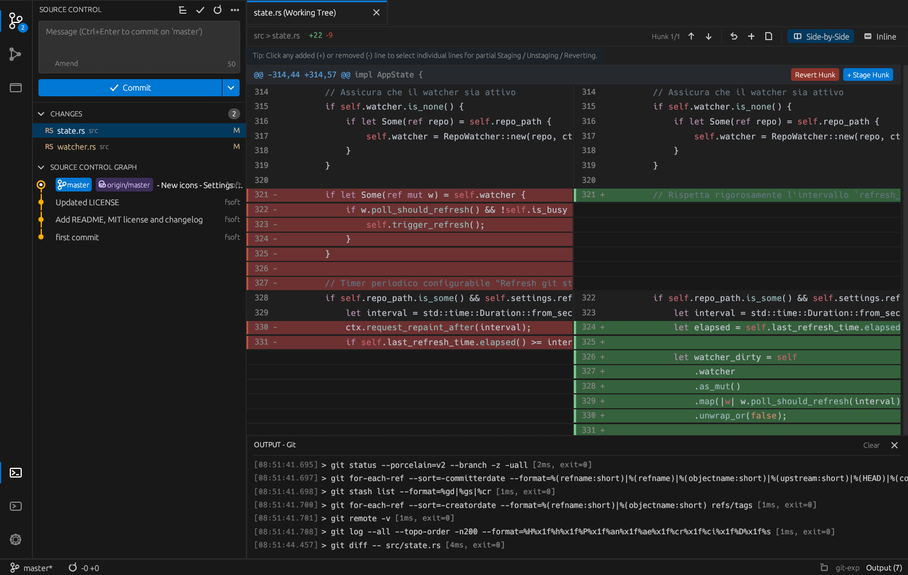

#  git-exp



A graphical Git interface inspired by the Source Control view of Visual Studio Code.
Built in Rust with [egui](https://github.com/emilk/egui) / eframe.

## Features

- Source Control sidebar with staged and unstaged changes
- Diff viewer with syntax highlighting (syntect)
- Commit graph view
- Command palette / quick pick (`Ctrl+Shift+P` or `F1`)
- Output panel showing the Git commands being run
- Status bar and activity bar, VS Code style
- VS Code inspired dark theme
- Automatic refresh through a filesystem watcher
- Native folder picker to open a repository

## Requirements

- [Rust](https://www.rust-lang.org/tools/install) (edition 2024, recent stable toolchain)
- `git` available in your `PATH`

## Build and run

```bash
cargo run --release
```

To open a specific repository at startup, pass its path as argument:

```bash
cargo run --release -- /path/to/repo
```

## Project layout

```
src/
  main.rs        application entry point
  state.rs       shared application state
  settings.rs    persisted settings
  theme.rs       VS Code like theme
  watcher.rs     filesystem watcher
  git/           Git CLI wrapper (status, diff, graph, operations)
  ui/            egui panels and widgets
```

## Vibe-coded

This code is **completely vibe-coded** using **Google Argon**.
No line was written by hand, so expect rough edges and review it before trusting it with important repositories.

## License

Released under the [MIT License](LICENSE).
